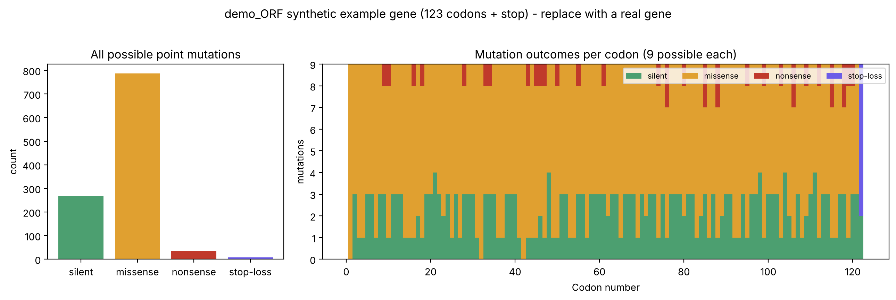

# Mutation Scanner

What happens if **every single letter** of a gene mutates?
This tool tries all 3 alternative bases at every position of a coding sequence and sorts each outcome into:

| Effect | Meaning |
|--------|---------|
| silent | same amino acid, protein unchanged |
| missense | a different amino acid |
| nonsense | creates a STOP codon, protein cut short |
| stop-loss | destroys the original STOP, protein runs on |



## Run it
```bash
pip install matplotlib
python mutation_scanner.py                    # demo gene in data/example.fasta
python mutation_scanner.py data/my_gene.fasta # your own gene
```
Outputs: `results/mutations.csv` (every mutation, one row each) and `results/mutation_landscape.png`.

## Try this
Download a real coding sequence (FASTA) from NCBI, e.g. human insulin (INS) or GFP, and compare the silent/missense/nonsense split with the demo. Genes with different codon usage give different numbers.

## Notes
- Input must start at the first base of a codon (an ATG start) and be a plain coding sequence.
- Uses the standard genetic code. Mitochondrial or other codes are not supported yet.

## Ideas to extend
- Add transition vs transversion counts
- Score missense changes by amino-acid similarity (BLOSUM62)
- Compare codon usage between two organisms
